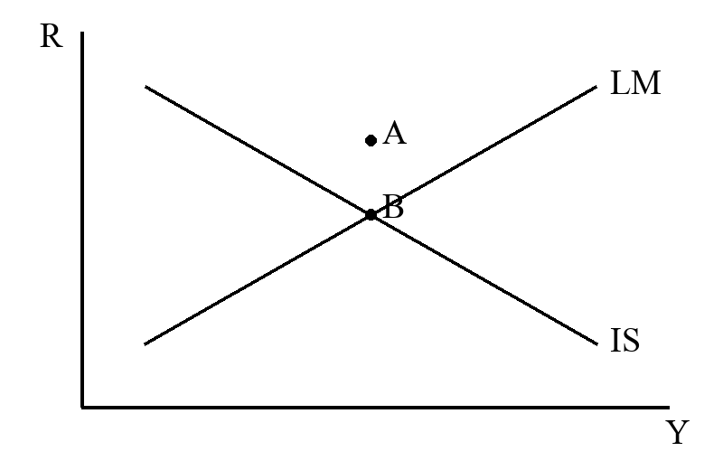

## 第001题 橘子岛国的国民收入核算

单元1 国民收入核算 | 原题 2.1.2* | 来源 1-001

假设一个橘子岛国只有两个公司：橘子公司生产橘子，橘子汁公司生产橘子汁。两家公司在2013年的收支如下。

|项目|橘子公司|橘子汁公司|
|:--|--:|--:|
|员工支出|1000000|200000|
|利息支出|50000|80000|
|缴纳税额|100000|200000|
|原材料支出|原表空白|2000000|
|销售额|卖给消费者1000000；卖给橘子汁公司2000000|卖给消费者3500000|

（1）请用产出法计算橘子岛国2013年的国内生产总值。

（2）请用支出法计算橘子岛国2013年的国内生产总值。

（3）请用收入法计算橘子岛国2013年的国内生产总值。

（4）假设在以上经济活动之外，橘子公司还从中国进口了10000的橘子，通过产出法、支出法、收入法三种方法计算该国新的国内生产总值。

【题设核对】原图“10000的橘子”未标明金额或数量单位，亦未说明进口后的用途；本题保留原文。

## 第002题 迷你国的GDP和平减指数

单元1 国民收入核算 | 原题 2.1.4* | 来源 1-002

迷你国只有两家企业：企业甲生产小麦，企业乙生产面包。2011年，企业甲生产50000千克小麦，以每千克3元的价格卖给企业乙20000千克，以每千克3元的价格出口25000千克，剩余5000千克以每千克3元计入库存。企业甲支付工资50000元。企业乙生产50000个面包，以每个2元的价格全部卖给本国，支付工资20000元。除从本国购入的50000个面包外，迷你国还以每个1元的价格进口15000个面包。

（1）用支出法求迷你国2011年的GDP。

（2）用生产法求迷你国2011年的GDP。

（3）以2010年为基年，2011年的实际GDP为180000元，求2011年的GDP平减指数和通货膨胀率。

## 第003题 劳动需求和最低实际工资

单元2 古典经济与要素市场 | 原题 3.1.2* | 来源 1-003

考虑一个经济，生产函数为 $Y=K^{1/3}L^{2/3}$。经济拥有1000单位资本和1000单位工人。工人的名义工资水平为 $W$，一般物价水平为 $P$。

（1）把劳动需求表示为实际工资和资本存量的函数。

（2）如果实际工资可以调整至劳动市场均衡，实际工资是多少？均衡时的就业量、产出和工人所得的总工资量是多少？

（3）如果政府要求企业把实际工资上涨到1，就业量如何变化？

## 第004题 可贷资金市场与储蓄

单元2 古典经济与要素市场 | 原题 3.2.4* | 来源 1-004

考虑三部门古典经济。

（1）什么使经济中可贷资金市场的需求和供给均衡？

（2）如果政府增加税收1亿元，边际消费倾向为0.6，公共储蓄、私人储蓄、国民储蓄和投资如何变化？

（3）如果投资满足 $I(r)=a-3r$，投资以亿元计量，利率以百分之一计量，那么在第（2）问的条件下，利率如何变化？

（4）假定消费者信心提高，增加了消费者对未来收入的预期，从而增加了他们现在希望消费的数量，可解释为消费函数向上移动。公共储蓄、私人储蓄、国民储蓄和投资如何变化？请结合图形说明。

## 第005题 商业银行体系的存款创造

单元3 货币与通货膨胀 | 原题 4.1.2* | 来源 1-005

设商业银行准备金率为 $r$。商业银行只能向公众发放贷款，公众对所获贷款的现金持有率为 $c$，把其余部分存入下一级银行。例如，$c=50\%$ 时，公众获得100元贷款，持有50元现金，把另外50元存入下一级银行。在这样的银行体系和制度安排下，中央银行向第一级商业银行注入1元现金。

（1）商业银行系统总共能创造出多少存款？

（2）商业银行系统的准备金会增加多少？

（3）公众手中持有的现金会增加多少？

## 第006题 货币乘数的推导与比较

单元3 货币与通货膨胀 | 原题 4.2.1* | 来源 1-006

原专题：货币乘数

（1）推导货币乘数 $m$ 与通货—存款比率 $cr$、存款准备金率 $rr$ 的关系式。

（2）若通过调整 $cr$ 或 $rr$ 增加货币供给，哪一项调整对货币乘数的影响更大？说明理由。

## 第007题 数量方程与通货膨胀

单元3 货币与通货膨胀 | 原题 5.1.4 21真题 课后题2 | 来源 1-007

货币需求函数为 $(M/P)^d=kY$。$M$ 以每年10%的速度增长，$Y$ 以每年4%的速度增长。假设 $k$ 是常数，价格为 $P$。

（1）求年通货膨胀率。

（2）求 $k$ 与货币流通速度 $V$ 的关系。

（3）如果金融创新导致 $V$ 以 $\theta$ 的速度增长，求此时的年通货膨胀率。

## 第008题 货币需求的收入弹性

单元3 货币与通货膨胀 | 原题 5.1.5* 22真题 | 来源 1-008

设货币需求函数为 $L_d=M/P=\sqrt{Y}/(\lambda i)$。其中 $i$ 为利率，$\lambda$ 为常数，$Y$ 为产出。

（1）产出增加10%，$M/P$ 如何变化？

（2）求货币流通速度。

（3）当 $\lambda$ 上升，$V$ 如何变化？

## 第009题 货币流通速度和政策中间目标

单元3 货币与通货膨胀 | 原题 5.1.6* | 来源 1-009

根据货币数量方程 $MV=PY$（$M,V,P,Y$ 分别为货币数量、货币流通速度、价格水平、真实产出），分析下列问题。

（1）若政府目标是保持真实产出相对稳定，在货币流通速度不变的条件下，政府如何保持价格水平稳定？

（2）当真实货币需求函数可表示为 $L(Y,i)=Y\cdot L(i)$（$L,Y,i$ 分别为真实货币数量、真实产出、名义利率）时，货币流通速度的本质是什么？

（3）哪些因素可能导致货币流通速度不稳定？为什么？

（4）利用IS-LM曲线说明：货币流通速度稳定但产品市场均衡变得不确定时，货币政策中间目标应盯住利率还是货币数量？为什么？

（5）利用IS-LM曲线说明：货币流通速度变得不稳定但产品市场均衡确定时，货币政策中间目标应盯住利率还是货币数量？为什么？

## 第010题 特殊货币需求与铸币税

单元3 货币与通货膨胀 | 原题 5.2.1* | 来源 1-010

原专题：特殊的货币数量方程

给定货币需求 $\ln(M/P)=a-bi+\ln Y$，其中 $Y$ 以速率 $g$ 增长，实际利率 $r$ 恒定。

（1）若货币供给在稳态下以速率 $\mu$ 增长，求稳态名义利率 $i$。

（2）使“增发货币获得的实际收入”（铸币税）最大时，求最优稳态通货膨胀率 $\pi$ 与货币供给增长率 $\mu$。

## 第011题 柯布道格拉斯模型与黄金律

单元4 经济增长 | 原题 增长专题1.1 | 来源 1-011

原专题：常规思路练手题目

假定生产函数为柯布—道格拉斯函数。

（a）将在平衡增长路径上每单位有效劳动的资本存量 $k^*$、产量 $y^*$ 和消费 $c^*$ 表示为模型参数 $s,n,\delta,g,\alpha$ 的函数。

（b）每单位有效劳动资本存量 $k$ 的黄金律值是多少？

（c）为得到第（b）问的黄金律资本存量，所需储蓄率是多少？

## 第012题 人口负增长与索洛稳态

单元4 经济增长 | 原题 增长专题1.2 | 来源 1-012

原专题：常规思路练手题目

（18分）索洛模型的生产函数为 $Y=K^\alpha(AN)^{1-\alpha}$，$Y$ 为产出，$K$ 为生产性资本，$A$ 为技术水平，$N$ 为劳动力，$\alpha\in(0,1)$。折旧率为 $\delta$，技术进步率为 $g_A$，人口增长率为 $g_N$。

（1）劳动力增长率为−1%，总产出增长率为2%，资本存量不变，技术水平的增长率是多少？（4分）

（2）变换生产函数形式，将单位有效工人产出表示为每单位有效工人资本存量的函数。（3分）

（3）定义该经济体的稳态均衡，求稳态的每单位有效工人资本存量及产出，将其表示为模型参数的函数。（8分）

（4）有观点认为：人口负增长、其他条件不变时，长期GDP增速将放缓，国力衰减，个人生活水平下滑。索洛增长模型是否支持这一观点？简要讨论理由。（3分）

## 第013题 技术进步的表示与黄金律产出

单元4 经济增长 | 原题 增长专题1.3 | 来源 1-013

原专题：常规思路练手题目

考虑索洛增长模型，$Y_t=A_tK_t^\theta L_t^{1-\theta}$，$Y_t,K_t,L_t$ 分别为 $t$ 期总产出、资本存量、劳动力存量，$0<\theta<1$。技术进步满足 $A_t=h_t^{1-\theta}$，$h_t=h_0e^{gt}$；劳动力存量 $L_t=L_0e^{nt}$。$s,\delta$ 分别为储蓄率和资本折旧率。

（1）推导稳态条件下有效劳动的人均产出 $y^*$，分析 $\theta,s,g,n,\delta$ 对其的影响。

（2）推导黄金律水平下的人均产出 $(Y/L)_{gold}$，分析 $\theta,s,g,n,\delta$ 对其的影响。

## 第014题 含AK项的增长模型

单元4 经济增长 | 原题 增长专题2.3 26软微真题 | 来源 1-016

原专题：常规思路考试较难题目

考虑生产函数 $Y=AK+K^\alpha L^{1-\alpha}$，$A>0$，$\alpha\in(0,1)$，$Y,K,L$ 分别为总产出、总资本和总劳动。储蓄率为 $S$，劳动人口增长率为 $n$，折旧率为 $\delta$，资本积累方程为 $\dot K=SY-\delta K$。人均资本水平能否实现长期增长？若能，参数需要满足什么条件？

## 第015题 资本收入全部用于储蓄

单元4 经济增长 | 原题 增长专题2.1 | 来源 1-014

原专题：常规思路考试较难题目

假定资本 $K$ 和劳动 $L$ 均按其边际产品获得报酬，$w=\partial F(K,AL)/\partial L$，$r=\partial F(K,AL)/\partial K$。所有资本收入被储蓄，所有劳动收入被消费，因此 $\dot K=[\partial F(K,AL)/\partial K]K-\delta K$。

（a）该经济是否收敛到平衡增长路径？

（b）将平衡增长路径上的每单位有效劳动资本存量 $k$ 与其黄金律水平比较。

## 第016题 含劳动替代项的生产函数

单元4 经济增长 | 原题 增长专题2.2 | 来源 1-015

原专题：常规思路考试较难题目

索洛模型的生产函数为 $Y=(K+\phi L)^\alpha L^{1-\alpha}$，储蓄率为 $s$，劳动力增长率为 $n$。

（1）若 $dK_t/dt=sY_t-\delta K_t$，推导 $K/L$ 关于时间的变化方程。

（2）当 $\phi$ 变化时，稳态资本量和 $MP_L$ 如何变化？

（3）若 $s^*$ 为黄金律时的储蓄率，说明 $s^*$ 与 $\alpha$ 的大小关系。

## 第017题 三类技术进步下的稳态处理

单元4 经济增长 | 原题 增长专题3.0 | 来源 1-017

原专题：k、y新定义的题目

当 $A$ 随时间增长而非常数时，分别写出以下三种技术进步情形下求稳态的处理方式。

（1）$Y=F(K,AL)$：劳动增进型（哈罗德中性）技术进步。

（2）$Y=F(AK,L)$：资本增进型技术进步。

（3）$Y=AF(K,L)$：希克斯中性技术进步。

【原标注】知识梳理（来源1-017）

【原批注】第一种省略，就是教材的常规处理。（来源1-017）

## 第018题 外生技术进步和内生技术水平

单元4 经济增长 | 原题 增长专题3.1 | 来源 1-020

原专题：k、y新定义的题目

生产函数为 $Y=AK^\alpha L^{1-\alpha}$，储蓄率为0.1，人口增长率 $n=0.01$，资本折旧率 $d=0.01$。

（1）计算劳动所得与资本所得在总收入中的份额。

（2）假设技术水平 $A$ 以2%的速度增长，计算总产出和人均资本存量的均衡增长率。

（3）假设 $A=(4K/L)^{1-\alpha}$，$\alpha=0.5$，将生产函数变为 $Y=bK$，计算均衡的人均资本和总产出增长率。

## 第019题 资本利用率变化

单元4 经济增长 | 原题 增长专题3.2 | 来源 1-021

原专题：k、y新定义的题目

生产函数为 $Y=(uK)^\alpha L^{1-\alpha}$，$K,L$ 分别为资本存量和劳动投入，$u$ 为资本利用率，$0<\alpha<1$。人口按速率 $n$ 增长，资本折旧率为 $\delta$，储蓄率为 $s$。根据索洛模型回答下列问题。

（1）求稳态资本—产出比率、稳态人均资本存量及其黄金律水平。

（2）分析资本利用率改变对人均产出的即刻影响，以及随时间推移的动态影响。

## 第020题 土地约束与持续增长

单元4 经济增长 | 原题 增长专题3.3 25软微真题 | 来源 1-022

原专题：k、y新定义的题目

生产函数为 $Y=K^\alpha(AL)^\beta R^{1-\alpha-\beta}$，$R$ 为土地数量。原题假设 $\alpha>0,\beta>0,\alpha+\beta<0$。生产要素按 $\dot K=sY-\delta K$、$\dot A=gA$、$\dot L=nL$ 和 $\dot R=0$ 变动。

（1）该经济是否有唯一且稳定的平衡增长路径？即 $Y,K,L,A,R$ 是否会以不变但不必相同的速率增长？若是，增长率各是多少？若不是，为什么？

（2）根据你的答案，以土地为代表的自然资源存量不变是否意味着持续增长不可能？请解释。

【题设核对】原图确实写作 $\alpha+\beta<0$，与前两项正值条件冲突，疑为 $\alpha+\beta<1$。本题保留原条件，训练前请核对。

【原批注】25软微真题，建议看视频讲解。（来源1-022）

## 第021题 人力资本与规模报酬递增

单元4 经济增长 | 原题 增长专题3.4及4.3 | 来源 1-023

原专题：k、y新定义的题目；联立增长率求解稳态

含人力资本的新经济增长模型为 $Y(t)=[K(t)]^\alpha[(1-a_H)H(t)]^\beta$，$\dot H(t)=Ba_HH(t)$，$\dot K(t)=sY(t)$。假设 $\alpha+\beta>1$，$a_H,B>0$；同题另一页还给出 $0<\alpha<1,0<\beta<1$。

（1）$H$ 的增长率是多少？

（2）该经济是否收敛于平衡增长路径？如果是，路径上 $K$ 和 $Y$ 的增长率是多少？

【原批注】本题在第三小节已经用新定义k法做了，也可以用联立增长率来做。（来源1-027）

## 第022题 实物资本与人力资本比例

单元4 经济增长 | 原题 索洛拓展6 | 来源 1-039

原专题：索罗拓展10题

生产函数 $Y(t)=K(t)^\alpha H(t)^{1-\alpha}$，$0<\alpha<1$。资本动态方程为 $\dot K(t)=s_KY(t)$，$\dot H(t)=s_HY(t)$。

（1）证明：无论正的初始 $K,H$ 为何，比例 $K/H$ 都收敛到平衡增长路径水平 $(K/H)^*$。

（2）收敛后，$K,H,Y$ 的增长率各是多少？

（3）平衡增长路径上 $Y$ 的增长率如何依赖于 $s_K,s_H$？

（4）若开始时 $K/H<(K/H)^*$，$Y$ 的初始增长率大于、小于还是等于平衡增长路径上的增长率？

## 第023题 体现在资本中的技术进步

单元4 经济增长 | 原题 增长专题3.5 | 来源 1-024

原专题：k、y新定义的题目

关于技术进步的一个观点是：$t$ 时建造的资本品，其生产率由 $t$ 时的技术状态决定，不受随后技术进步的影响。这称为被体现的技术进步，即技术进步在提高产量前必须体现于新资本品中。

（a）修改索洛模型，使技术进步为资本增进型而非劳动增进型。为使平衡增长路径存在，设 $Y(t)=[A(t)K(t)]^\alpha L(t)^{1-\alpha}$，$\dot A(t)=gA(t)$。证明经济收敛于平衡增长路径，并求路径上 $Y,K$ 的增长率。

（b）令 $Y(t)=J(t)^\alpha L(t)^{1-\alpha}$，$J(t)$ 为有效资本存量，$\dot J(t)=sA(t)Y(t)-\delta J(t)$。其中 $A(t)$ 意味着 $t$ 时投资的生产率取决于当时的技术。证明经济收敛于平衡增长路径，并求路径上 $Y,J$ 的增长率。

（c）平衡增长路径上产量对 $s$ 的弹性是多少？

## 第024题 资本与知识积累的联立增长

单元4 经济增长 | 原题 增长专题4.1 | 来源 1-025

原专题：联立增长率求解稳态

总量生产函数为 $Y(t)=K(t)^\alpha[A(t)L(t)]^{1-\alpha}$。资本和知识积累方程为 $\dot K(t)=sY(t)$，$\dot A(t)=Y(t)^\varphi$。$s$ 为储蓄率，$\varphi\in(0,1)$，人口增长率为 $n$。（每问5分，共20分）

（1）给出知识积累方程的经济学解释。

（2）将 $g_K(t)=\dot K(t)/K(t)$ 和 $g_A(t)=\dot A(t)/A(t)$ 表示为 $A(t),K(t),L(t)$ 的函数。

（3）是否存在资本和知识积累增长率为常数的稳态？若存在，求两者的稳态增长率。

（4）储蓄率如何影响稳态人均产出增长率？

## 第025题 生产的知识副产品

单元4 经济增长 | 原题 增长专题4.2 | 来源 1-026

原专题：联立增长率求解稳态

生产函数为 $Y(t)=K(t)^\alpha[A(t)L(t)]^{1-\alpha}$，$L=1$ 且保持不变。$\dot K(t)=sY(t)$；知识积累是产品生产的副产品，$\dot A(t)=BY(t)$。

（1）用 $A(t),K(t)$ 和各参数表示 $g_A(t),g_K(t)$。

（2）在 $(g_A,g_K)$ 空间画出 $\dot g_A=0$ 线和 $\dot g_K=0$ 线。

（3）经济是否会收敛到均衡增长路径？若是，路径上 $K,A,Y$ 的增长率各是多少？

（4）$s$ 增加如何影响长期增长？

## 第026题 政府支出与索洛稳态

单元4 经济增长 | 原题 增长专题5.1 | 来源 1-028

原专题：加入政府的三部门索罗模型（Y=C+I+G）

（20分）生产函数 $Y=K^{1/2}(AN)^{1/2}$，储蓄率 $s=40\%$，折旧率 $\delta=10\%$，人口增长率 $g_N=6\%$，技术进步率 $g_A=4\%$。

（1）求稳态每有效工人的资本量、有效工人的产出增长率、人均产出增长率和总产出增长率。（5分）

（2）求稳态有效人均消费最大化时的储蓄率和有效人均产出。（4分）

现引入政府支出 $G$，政府收支平衡 $T=G$，每个工人承担的政府支出 $g=G/N$，工人总消费 $C=(1-s)(Y-T)$。此时 $A=1,g_N=g_A=0$，折旧率不变。

（3）写出资本积累方程，用图形分析稳态可能存在两个不同的 $k^*$。（5分）

（4）取较大的稳态 $k^*$（较小者不稳定），$g$ 提高对稳态人均资本和工人总消费有何影响？（3分）

（5）若 $G=zY$，是否有两个稳态解？若 $z$ 下降，稳态人均资本与人均消费如何变化？（3分）

## 第027题 政府消费与政府投资

单元4 经济增长 | 原题 增长专题5.2 | 来源 1-029

原专题：加入政府的三部门索罗模型（Y=C+I+G）

（20分）在离散时间索洛模型中引入政府支出，$Y(t)=C(t)+I(t)+G(t)$，资本积累为 $K(t+1)=I(t)+(1-\delta)K(t)$，$\delta$ 为资本折旧率。没有技术进步，人口增长率为零，生产函数符合标准索洛假定。政府支出 $G(t)=\sigma Y(t)$。

（1）若设定 $C(t)=sY(t)$，此设定在该模型中是否合理？（6分）

（2）假定政府支出部分来自私人消费，$C(t)=(s-\lambda\sigma)Y(t)$，$\lambda\in[0,1]$。提高政府支出水平（提高 $\sigma$）对人均资本稳态有何影响？（8分）

（3）假定政府支出中比例 $\phi$ 用于资本存货，社会总投资为 $I(t)=[1-s-(1-\lambda)\sigma+\phi\sigma]Y(t)$。证明：如果 $\phi$ 足够大，人均资本的稳态水平会随政府支出提高而增加，并分析该结论是否合理。（6分）

## 第028题 双资本积累与黄金律

单元4 经济增长 | 原题 索洛拓展5 | 来源 1-038

原专题：索罗拓展10题

（15分）生产函数 $Y_t=K_t^\alpha H_t^\beta N_t^{1-\alpha-\beta}$，$Y_t,K_t,H_t,N_t$ 分别为总产出、实物资本存量、人力资本存量和劳动力数量，劳动力数量也是人口数量。$\alpha,\beta$ 为相应弹性参数，市场完全竞争。

资本运动方程为 $K_{t+1}=(1-\delta_K)K_t+I_t^K$，$H_{t+1}=(1-\delta_H)H_t+I_t^H$。$\delta_K,\delta_H$ 为两种资本的折旧率，投资满足 $I_t^K=s_KY_t$、$I_t^H=s_HY_t$。$s_K,s_H$ 为对应储蓄率，产品市场出清条件 $Y_t=C_t+I_t^K+I_t^H$，$C_t$ 为总消费。

（1）写出稳态需要满足的条件，并求稳态人均产出。（8分）

（2）求稳态人均消费最大化即黄金律下的两项最优储蓄率，并求该情况下的人均产出。（7分）

## 第029题 离散时间索洛模型

单元4 经济增长 | 原题 增长专题6.1及6.2 | 来源 1-031

原专题：离散的索罗模型

设 $Y_t=F(K_t,A_tL_t)$，$F$ 具有规模报酬不变性质，密集形式生产函数满足稻田条件。$A_{t+1}=(1+g)A_t$，$L_{t+1}=(1+n)L_t$，$K_{t+1}=K_t+sY_t-\delta K_t$。$k_t$ 表示每单位有效劳动的资本存量。

（1）求作为 $k_t$ 函数的 $k_{t+1}$ 的表达式。

（2）画出 $k_{t+1}$ 关于 $k_t$ 的图形。经济处在均衡增长路径吗？若 $k$ 的初始水平不同于均衡增长路径上的值，经济会收敛到该路径吗？

（3）求每单位有效劳动消费关于均衡增长路径资本存量 $k$ 的表达式。当 $k$ 使该消费最大化时，资本边际产品 $f'(k)$ 是多少？

（4）若生产函数为柯布—道格拉斯形式，分别求 $k_{t+1}$ 关于 $k_t$ 的表达式，以及均衡增长路径上的 $k^*$。

## 第030题 索洛模型与AK模型的储蓄效应

单元4 经济增长 | 原题 增长专题6.3 | 来源 1-032

原专题：离散的索罗模型

家庭按收入的既定比例 $1-s$ 消费，$s\in(0,1)$ 为储蓄率。生产函数 $Y_t=zK_t^\alpha N_t^{1-\alpha}$，$\alpha\in(0,1)$。$Y_t,K_t,N_t$ 为总产出、资本存量和劳动人口；$z$ 为技术水平参数，$N_{t+1}=(1+n)N_t$，$n\geq0$，折旧率 $\delta\in(0,1)$。

（1）求长期人均收入水平及其增长率。（5分）

（2）储蓄率上升如何影响长期人均收入水平及其增长率？（3分）

（3）若生产函数变为 $Y_t=zK_t$，求长期人均收入水平及其增长率，并分析储蓄率上升的影响。（8分）

（4）第（2）、（3）问中储蓄率的影响有何不同？为什么？（4分）

## 第031题 索洛模型的要素收入

单元4 经济增长 | 原题 索洛拓展1 | 来源 1-033

原专题：索罗拓展10题

资本 $K$ 和劳动 $L$ 按各自边际产品获得报酬，$k=K/(AL)$ 为每单位有效劳动资本存量，$w=\partial F(K,AL)/\partial L$，$r=\partial F(K,AL)/\partial K$。

（a）求劳动的边际产品 $w$。

（b）若劳动和资本按边际产品取得报酬，规模报酬不变是否意味着两要素总收入等于总产量？

（c）平衡增长路径上的索洛经济是否表现出资本报酬率 $r$ 近似不变、产量分配给资本和劳动的比例各自大致不变的性质？求路径上 $w,r$ 的增长率。

（d）假定开始时 $k<k^*$。随着 $k$ 向 $k^*$ 移动，$w$ 的增长率如何变化？资本报酬率 $r$ 的增长率如何变化？

## 第032题 里昂惕夫函数与要素闲置

单元4 经济增长 | 原题 索洛拓展2 | 来源 1-035

原专题：索罗拓展10题

生产函数 $Y(t)=\min[c_KK(t),c_Le^{gt}L(t)]$，$c_K,c_L,g$ 均为正。$\dot L(t)=nL(t)$，$\dot K(t)=sY(t)-\delta K(t)$，并假定 $c_KK(0)=c_LL(0)$。

（a）对所有 $t$，在什么条件下 $c_KK(t)=c_Le^{gt}L(t)$ 成立？如果 $c_K,c_L,g,s,\delta,n$ 由不同因素决定，有无理由期望该条件成立？

（b）若 $c_Le^{gt}L(t)$ 增长快于 $c_KK(t)$，失业率随时间如何变化？

（c）若 $c_KK(t)$ 增长快于 $c_Le^{gt}L(t)$，被利用资本占资本存量的比例随时间如何变化？

## 第033题 固定比例生产函数的稳态

单元4 经济增长 | 原题 索洛拓展3 | 来源 1-036

原专题：索罗拓展10题

索洛模型采用固定比例生产函数 $Y=\min(aK,bL)$，$a,b>0$ 分别为每单位资本和每单位劳动的产出。人口增长率为 $n$，折旧率为 $\delta$，储蓄率为 $s$。

（1）推导人均产出 $y=Y/L$ 与人均资本 $k=K/L$ 的关系 $y=f(k)$。（提示：经济体选择在要素不被浪费的情况下运行。）

（2）写出人均资本 $k$ 的动态方程。

（3）求稳定的人均资本存量 $k^*$。

（4）什么条件下该经济能实现人均产出的持续增长？这一结论与标准索洛模型有何不同？

## 第034题 人力资本模型的二维动态

单元4 经济增长 | 原题 索洛拓展4 | 来源 1-037

原专题：索罗拓展10题

生产函数 $Y=K^\alpha H^\beta(AL)^{1-\alpha-\beta}$，$\alpha,\beta>0$，$\alpha+\beta<1$。$L$ 为工人数，$H$ 为技能总量。动态方程为 $\dot L=nL$、$\dot A=gA$、$\dot K=s_kY-\delta K$、$\dot H=s_hY-\delta H$。其中 $0<s_k,s_h<1$，$n+g+\delta>0$，$L(0),A(0),K(0),H(0)$ 已知且严格为正。定义 $y=Y/(AL)$，$k=K/(AL)$，$h=H/(AL)$。

（a）用 $k(t),h(t)$ 与模型参数表示 $y(t)$。

（b）用 $k(t),h(t)$ 与模型参数表示 $\dot k(t)$，在 $(k,h)$ 空间画出 $\dot k=0$ 的点。

（c）用 $k(t),h(t)$ 与模型参数表示 $\dot h(t)$，在 $(k,h)$ 空间画出 $\dot h=0$ 的点。

（d）经济会收敛于平衡增长路径吗？为什么？若收敛，路径上的工人平均产出增长率是多少？若不收敛，工人平均产出一般会如何随时间变化？

## 第035题 非标准生产函数的均衡

单元4 经济增长 | 原题 索洛拓展7 | 来源 1-040

原专题：索罗拓展10题

考虑生产函数 $F(K,L)=\alpha L+gK-\alpha L\exp(-\alpha K/L)$，其中 $\alpha>0$ 为正常数。

（1）这是一个新古典生产函数吗？

（2）考虑该生产函数下的Solow模型，讨论均衡点的存在性、唯一性和稳定性。

## 第036题 南北技术扩散

单元4 经济增长 | 原题 索洛拓展8 | 来源 1-041

原专题：索罗拓展10题

世界由北方和南方两个地区组成。地区 $i$（$i=N,S$）的产出为 $Y_i(t)=K_i(t)^\alpha[A_i(t)(1-a_{Li})L_i]^{1-\alpha}$，资本积累为 $\dot K_i(t)=s_iY_i(t)$。北方开发新技术：$\dot A_N(t)=Ba_{LN}L_NA_N(t)$。

南方通过学习北方获得技术进步：当 $A_N(t)>A_S(t)$ 时，$\dot A_S(t)=\mu a_{LS}L_S[A_N(t)-A_S(t)]$；否则 $\dot A_S(t)=0$。$a_{LN}$ 为北方从事研发的劳动力比例，$a_{LS}$ 为南方向北方学习技术的劳动力比例。$L_N,L_S$ 固定不变，其余为标准记号。

（1）北方工人平均产出的长期增长率是多少？

（2）定义 $Z(t)=A_S(t)/A_N(t)$，把 $\dot Z$ 表示为 $Z$ 和模型参数的函数。$Z$ 是否稳定？若是，收敛于何值？南方工人平均产出的长期增长率是多少？

（3）假设 $a_{LN}=a_{LS}$ 且 $s_N=s_S$，两地均收敛至平衡增长路径时，南方与北方工人平均产出的比率是多少？

## 第037题 马尔萨斯增长模型

单元4 经济增长 | 原题 索洛拓展9 | 来源 1-043

原专题：索罗拓展10题

生产函数 $Y=AL^{1-\alpha}N^\alpha$，$A$ 为技术，$L$ 为外生给定的土地数量，$N$ 为总人口，$0<\alpha<1$。人口动态方程为 $N'/N=g(C)$，$N'$ 为下一期人口，$C$ 为人均消费，$g'>0,g''<0$。该经济没有物质资本，每个人生存一期（原图作“整存一期”，据语义整理）。

（1）求稳态均衡中的人均消费和人口数量。（7分）

（2）技术的正向冲击如何影响稳态均衡？据此讨论马尔萨斯增长模型的理论贡献和缺陷。（8分）

## 第038题 预期通胀下降与实际利率

单元5 IS-LM与总需求 | 原题 12.1.1 25真题 | 来源 1-044

原专题：微分求导

基本IS-LM模型为 $Y=C(Y-T)+I(i-E\pi)+G$，$M/P=L(i,Y)$，实际利率 $r=i-E\pi$。满足 $0<C'_{Y-T}<1$、$I'_r<0$、$L'_i<0$、$L'_Y>0$。请分析预期通货膨胀 $E\pi$ 下降如何影响实际利率。

## 第039题 内生税收与IS斜率

单元5 IS-LM与总需求 | 原题 12.1.2 24真题 | 来源 1-045

原专题：微分求导

（15分）传统IS方程为 $Y=C(Y-T)+I(i)+G$，其中 $0<C'(Y-T)<1$、$I'(i)<0$，税收外生给定。现考虑税收是总产出的函数，即 $T=T(Y)$，并满足 $T'(Y)>0$、$1-C'(Y-T)[1-T'(Y)]>0$。$T(Y)$ 的增加，相比税收外生给定的情况，会使IS曲线更陡峭还是更平缓？

## 第040题 减税使产出扩大的条件

单元5 IS-LM与总需求 | 原题 12.1.3 23真题 | 来源 1-046

原专题：微分求导

（15分）IS方程为 $Y=C(Y-T)+I(r)+G$，LM方程为 $M/P=L(r,Y-T)$，实际货币余额需求取决于可支配收入。已知 $0<C'_{Y-T}<1$、$I'_r<0$、$L'_r<0$、$L'_{Y-T}>0$。政府减税 $dT<0$，求使均衡产出增大 $dY>0$ 的边界条件。

【原文校记】原图LM式第二个参数误写为 $T-T$；本题依据同句“可支配收入”及原图导数下标整理为 $Y-T$。

## 第041题 财政扩张挤入投资的条件

单元5 IS-LM与总需求 | 原题 12.1.4 20真题 | 来源 1-047

原专题：微分求导

（15分）IS曲线为 $Y=C(Y-T)+I(r,Y)+G$，LM曲线为 $M/P=L(r,Y)$。假设 $C'(Y-T)\in(0,1)$，$I_r<0$，$I_Y\in(0,1)$，$L_r<0$，$L_Y>0$，且 $C'(Y-T)+I_Y<1$。$Y,C,T,I,r,G,M/P,L(r,Y)$ 分别表示总需求、消费、税收、投资、利率、政府支出、实际货币供给和实际货币需求。实施扩张性政府支出政策 $dG>0$，求均衡投资增大 $dI>0$ 的边界条件。

## 第042题 消费对利率敏感时的货币政策

单元5 IS-LM与总需求 | 原题 12.1.5 | 来源 1-048

原专题：微分求导

封闭经济的IS-LM模型为 $Y=C+I(r)+G$、$M/P=K(Y)+L(r)$。忽略税负，比较两种消费假设：A为 $C=C(Y,r)$，$C_Y>0,C_r<0$；B为 $C=C(Y)$，$C_Y>0$。

（1）分别计算两种假设下IS曲线的斜率，哪种情况下更陡？

（2）分别计算两种假设下货币政策对均衡产出的边际影响 $dY/d(M/P)$。

（3）依据第（1）问画出IS-LM曲线，用图说明货币政策在哪种情况下更有效。

## 第043题 中央银行控制真实利率的能力

单元5 IS-LM与总需求 | 原题 12.1.6 | 来源 1-049

原专题：微分求导

经济由两个方程描述：IS方程 $Y=Y(r)$，$Y'(r)<0$；货币市场均衡条件 $m-p=\widetilde L(r+\pi^e,Y)$，$\widetilde L_{r+\pi^e}<0$、$\widetilde L_Y>0$。$m,p$ 分别为 $\ln M,\ln P$。

（1）假设 $P=\bar P,\pi^e=0$，求 $dr/dm$，说明货币供给增加是否降低真实利率。

（2）价格对货币供给增加做出局部反应，$dp/dm$ 外生且 $0<dp/dm<1$，仍假设 $\pi^e=0$。求 $dr/dm$，说明货币供给增加是否降低真实利率。要获得既定的 $r$ 变动，与第（1）问相比，$m$ 需发生更大、更小还是相同幅度的变化？

（3）货币增加也影响预期通胀，$d\pi^e/dm$ 外生且为正，仍有 $0<dp/dm<1$。求 $dr/dm$，说明货币供给增加是否降低真实利率。要获得既定的 $r$ 变动，与第（2）问相比，$m$ 的变动幅度如何？

（4）存在完全且连续的价格调整，$dp/dm=1$、$d\pi^e/dm=0$。求 $dr/dm$，说明货币供给增加是否降低真实利率。

## 第044题 平衡预算对IS和AD的影响

单元5 IS-LM与总需求 | 原题 12.1.7 | 来源 1-050

原专题：微分求导

计划支出 $E=C(Y-T)+I(i-\pi^e)+G$，实际支出 $Y=E$。

（1）计算 $G,T$ 等量增加如何影响IS曲线的位置。具体而言，对于既定利率水平，即 $i-\pi^e$ 为常数，对产出 $Y$ 的影响是什么？给出数学推导。

（2）计算 $G,T$ 等量增加如何影响AD曲线的位置。对于既定的 $\pi$，对 $Y$ 的影响是什么？此时真实利率函数为 $r=r(Y,\pi)$，$r_Y>0,r_\pi>0$。给出数学推导。

（3）比较前两问的结果并解释。

## 第045题 固定利率与固定价格下的平衡预算

单元5 IS-LM与总需求 | 原题 12.1.8 26真题 | 来源 1-051

原专题：微分求导

IS方程 $Y=C(Y-T)+I(i)+G$，$0<C'(Y-T)<1$、$I'(i)<0$；LM方程 $M/P=L(i,Y)$，$L_i<0,L_Y>0$。考虑 $G,T$ 等量增加。

（1）对于既定利率 $i$，该政策对 $Y$ 的影响是什么？

（2）对于既定价格 $P$，该政策对 $Y$ 的影响是什么？

## 第046题 政策目标与冲击应对

单元5 IS-LM与总需求 | 原题 12.2.1 课后题10.3 | 来源 1-052

原专题：图形分析

考察美联储的目标如何影响它对冲击的反应。情景A中，美联储只关心维持价格水平稳定；情景B中，只关心把产出与就业维持在自然水平。解释两种情景下美联储如何应对下列情况。

（a）货币流通速度的外生下降。

（b）石油价格的外生提高。

## 第047题 财政货币政策的短期效应

单元5 IS-LM与总需求 | 原题 12.2.2 课后题12.1 | 来源 1-053

原专题：图形分析

根据IS-LM模型，说明以下情况下利率、收入、消费和投资在短期如何变动。每问包含合适的图形。

（a）中央银行增加货币供给。

（b）政府增加政府购买。

（c）政府增加税收。

（d）政府等量增加政府购买与税收。

## 第048题 需求冲击与稳定收入

单元5 IS-LM与总需求 | 原题 12.2.3 课后题12.2 | 来源 1-054

原专题：图形分析

用IS-LM模型预测以下冲击对收入、利率、消费和投资的影响。每种情况下说明美联储为保持初始收入水平应采取什么措施，答案要求使用图形。

（a）新型高速电脑芯片发明后，许多企业决定升级电脑系统。

（b）信用卡诈骗浪潮提高了人们使用现金交易的频率。

（c）畅销书《做一个富裕的退休人》（Retire Rich）说服公众提高收入中用于储蓄的比例。

（d）新任美联储主席为鸽派人士，该任命增加了预期通货膨胀。

## 第049题 IS和LM曲线的特殊情形

单元5 IS-LM与总需求 | 原题 12.2.4 课后题12.5 | 来源 1-055

原专题：图形分析

判断以下陈述的对错并解释。对正确陈述，讨论该特例下货币政策与财政政策的影响有何不寻常之处。

（a）若投资不取决于利率，LM曲线水平。

（b）若投资不取决于利率，IS曲线垂直。

（c）若货币需求不取决于利率，IS曲线水平。

（d）若货币需求不取决于利率，LM曲线垂直。

（e）若货币需求不取决于收入，LM曲线水平。

（f）若货币需求对利率极其敏感，LM曲线水平。

## 第050题 财政与货币政策组合

单元5 IS-LM与总需求 | 原题 12.2.5 课后题12.6 | 来源 1-056

原专题：图形分析

货币政策和财政政策常常同时变动。

（a）政府想提高投资但保持产出不变，IS-LM模型中什么样的政策组合可以实现这一目标？

（b）20世纪80年代初，美国政府减税并实施预算赤字，美联储实施紧缩性货币政策。这种组合应该有什么影响？

## 第051题 政策变动的短期与长期影响

单元5 IS-LM与总需求 | 原题 12.2.6 课后题12.7 | 来源 1-057

原专题：图形分析

用IS-LM图形描述以下变动对国民收入、利率、价格水平、消费、投资、实际货币余额的短期与长期影响。

（a）货币供给增加。

（b）政府购买增加。

（c）税收增加。

## 第052题 盯住货币量还是利率

单元5 IS-LM与总需求 | 原题 12.2.7 课后题12.8 | 来源 1-058

原专题：图形分析

美联储考虑两种货币政策：保持货币供给不变、允许利率调整；或调整货币供给以保持利率不变。在IS-LM模型中，哪种政策能在以下条件下更好地稳定产出？请解释。

（a）所有冲击来自产品与服务需求的外生变动。

（b）所有冲击来自货币需求的外生变动。

## 第053题 可支配收入决定货币需求

单元5 IS-LM与总需求 | 原题 12.2.8 课后题12.9 | 来源 1-060

原专题：图形分析

假定实际货币余额需求取决于可支配收入，货币需求方程为 $M/P=L(r,Y-T)$。用IS-LM模型讨论这一变化是否改变以下两项。

（a）对政府购买变动的分析。

（b）对税收变动的分析。

## 第054题 流动性偏好与费雪效应

单元5 IS-LM与总需求 | 原题 12.2.9 | 来源 1-061

原专题：图形分析

凯恩斯流动性偏好理论认为：货币紧缩使货币供给曲线左移，利率提高。费雪理论 $i=r+\pi$ 则认为：货币紧缩降低通胀率 $\pi$，实际利率不变，因此紧缩性货币政策降低利率。货币紧缩究竟提高还是降低利率？凯恩斯和费雪哪个正确？

## 第055题 财政赤字与投资的关系

单元5 IS-LM与总需求 | 原题 12.2.10 | 来源 1-062

原专题：图形分析

修改后的IS-LM模型中，产品和服务市场均衡为 $Y=C(Y-T)+I(Y,i)+G$。其中 $0<I_Y,1-MPC-I_Y,MPC<1$。政府政策利率 $i=\bar i$ 即为LM方程，先保持利率不变。

（1）政府通过增税减少赤字，私人储蓄如何变化？

（2）投资如何变化？

（3）中央银行如何调控，才能在增税减少赤字的同时使投资增加？

（4）结合推导，说明为什么赤字对投资的影响不确定。

## 第056题 不同理论下的政策效力

单元5 IS-LM与总需求 | 原题 12.2.11 | 来源 1-063

原专题：图形分析

结合图形，比较古典主义、凯恩斯主义和流动性陷阱下的IS-LM模型及其政策效力。

## 第057题 利率目标下的LM与AD

单元5 IS-LM与总需求 | 原题 12.2.12 19真题 | 来源 1-064

原专题：图形分析

表示货币市场均衡的LM曲线一般假定货币供给 $M$ 外生。假设政府希望通过调整 $M$，使利率始终等于 $i^*$。

（1）LM曲线的斜率是什么？简要分析。

（2）AD曲线的斜率是什么？简要分析。

## 第058题 非均衡状态的调整

单元5 IS-LM与总需求 | 原题 12.2.13 | 来源 1-065

原专题：图形分析

下图为标准IS-LM模型，市场均衡点为B，A点既不在产品市场均衡上，也不在货币市场均衡上。

{width=2.5in}

（1）说明A点的产品市场供需情况并解释原因。

（2）说明A点的货币市场供需情况并解释原因。

（3）说明经济体如何从A点收敛到B点，并用图画出。

## 第059题 可变税收与平衡预算乘数

单元5 IS-LM与总需求 | 原题 12.3.3 | 来源 1-067

三部门经济满足 $Y=AD$，$AD=C+I+G$，$C=C_0+cY_d$，$0<c<1$，$Y_d=Y+TR_0-T$，$T=T_0+tY$，$0<t<1$，$I=I_0$。

【原文校记】原图总需求式投资项写作 $I_y$，下文写作 $I=I_0$；此处统一记为 $I$。

（1）求政府购买乘数 $\Delta Y/\Delta G$、定量税乘数 $\Delta Y/\Delta T_0$ 和税率乘数 $\Delta Y/\Delta t$。

（2）当税率 $t$ 不变时，若 $\Delta T=\Delta G$，证明平衡预算乘数为1。

（3）当定量税 $T_0$ 不变时，若 $\Delta T=\Delta G$，证明平衡预算乘数为1。

（4）当 $t$ 和 $T_0$ 都可变时，若 $\Delta T=\Delta G$，证明平衡预算乘数为1。

## 第060题 IS-LM模型的完整代数推导

单元5 IS-LM与总需求 | 原题 12.3.2 课后题12.10 | 来源 1-066

假定消费是可支配收入的线性函数 $C(Y-T)=a+b(Y-T)$，$a>0,0<b<1$。$b$ 为边际消费倾向，$a$ 为自主消费。投资函数 $I(r)=c-dr$，$c,d>0$，$d$ 衡量投资对利率的敏感程度，$c$ 为自主投资。

（a）求 $Y$，表示为 $r,G,T$ 及 $a,b,c,d$ 的函数。

（b）IS斜率如何取决于投资对利率的敏感程度 $d$？参考第（a）问给出直观解释。

（c）100美元减税与100美元政府购买增加，哪个引起的IS水平移动更大？参考第（a）问解释。

现设实际货币余额需求为 $L(r,Y)=eY-fr$，$e,f>0$。$e,f$ 分别衡量货币需求对收入和利率的敏感程度。

（d）求 $r$，表示为 $Y,M,P,e,f$ 的函数。

（e）用第（d）问确定LM曲线在 $f$ 大还是小时更陡峭，并直观解释。

（f）$M$ 增加100美元引起的LM移动程度如何取决于：（i）$e$；（ii）$f$？

（g）利用第（a）、（d）问推导总需求曲线，将 $Y$ 表示为 $P,M,G,T$ 及模型参数的函数，不要包含 $r$。

（h）利用第（g）问证明总需求曲线斜率为负。

（i）利用第（g）问说明 $G,M$ 增加以及 $T$ 减少使总需求曲线右移。若 $f=0$，该结论如何变化？直观解释。

## 第061题 收入诱发投资与政策乘数

单元5 IS-LM与总需求 | 原题 12.3.4 | 来源 1-068

设 $C=\bar C+c(Y-T)$，$T=tY$，$I=\bar I-br+aY$，$G=40$，$M/P=kY-hr$。

（1）推导IS曲线，说明影响其斜率的因素。

（2）求政府购买乘数，并分析投资对收入的敏感程度 $a$ 对该乘数的影响。

（3）求货币政策乘数，并分析 $a$ 对该乘数的影响。

## 第062题 投资陷阱与凯恩斯效应

单元5 IS-LM与总需求 | 原题 12.4.1 | 来源 1-072

原专题：流动性陷阱与投资性陷阱

为什么说存在投资陷阱时，即使依然存在着“两分法”，凯恩斯效应仍然不起作用？

【原批注】不用做，听下讲解了解下投资性陷阱就行了。（来源1-072）

## 第063题 从简单收入决定到IS-LM乘数

单元5 IS-LM与总需求 | 原题 12.3.5 | 来源 1-069

设消费函数为 $C=c_0+c_1(Y-T)$，投资 $I$、政府支出 $G$ 和税收 $T$ 均为给定量。

（1）求均衡产出和乘数。

（2）现在设投资函数为 $I=b_0+b_1Y-b_2i$。求均衡产出。在给定利率下，自主支出变化对产出的影响是否大于第（1）问？为什么？假设 $c_1+b_1<1$。

（3）加入LM关系 $M/P=d_1Y-d_2i$，消去利率 $i$，求均衡产出及自主支出乘数。

（4）将第（3）问的乘数与第（1）问比较，解释消费、投资及货币需求函数中参数的作用。

## 第064题 流动性陷阱与价格调整

单元5 IS-LM与总需求 | 原题 12.4.2 21真题 | 来源 1-073

原专题：流动性陷阱与投资性陷阱

当名义利率很低时，经济陷入流动性陷阱。

（1）此时总需求曲线的斜率如何？

（2）如果价格完全灵活，总需求与总产出是否有关？

## 第065题 货币需求变化与曲线斜率

单元5 IS-LM与总需求 | 原题 12.4.3 | 来源 1-074

原专题：流动性陷阱与投资性陷阱

在标准IS-LM模型中回答下列问题。

（1）如果公众持有货币的意愿增加，会对经济产生什么影响？中央银行如何稳定产出？

（2）如果货币需求对利率非常敏感，LM曲线和AD曲线的斜率如何？

## 第066题 一般IS-LM模型的政策效果

单元5 IS-LM与总需求 | 原题 12.4.4 | 来源 1-075

原专题：流动性陷阱与投资性陷阱

设 $Y=C(Y)+I(r,Y)+G$，$M/P=L(r,Y)$，$P,G,M$ 为外生变量。已知 $0<C_Y<1$，$I_r<0$，$I_Y>0$（一般较小），$L_r<0$，$L_Y>0$。$I_r$ 和 $L_r$ 可以为 $-\infty$，其余一阶偏导数为正。

讨论财政政策和货币政策对均衡收入和利率的影响。

【原批注】不用做，听下讲解就行了。（来源1-075）

## 第067题 零利率下限与非常规货币政策

单元5 IS-LM与总需求 | 原题 12.4.5 | 来源 1-076

原专题：流动性陷阱与投资性陷阱

根据流动性陷阱理论，经济陷入流动性陷阱后，扩张性货币政策无法使利率进一步下降，因此政策无效。然而，次贷危机后，在美国市场名义利率接近零下限的情况下，美联储采取了以大量购买资产为主要特征的非常规货币政策，并取得较好效果。

（1）你认为在零利率下限处，非常规货币政策如何发生作用？

（2）非常规货币政策是否意味着流动性陷阱理论是错误的？

## 第068题 财政政策有效性的综合评价

单元5 IS-LM与总需求 | 原题 12.5.1 | 来源 1-077

原专题：文字分析

结合财政制度自动稳定器、财政政策的乘数效应和挤出效应三个概念，简要分析和评价财政政策的有效性。

## 第069题 大萧条中的支出冲击与货币假说

单元5 IS-LM与总需求 | 原题 12.5.2 | 来源 1-078

原专题：文字分析

下表显示美国1929—1940年大萧条期间经济指标的变化情况。

|年份|实际GNP|消费|投资|政府支出|名义利率|货币供给|物价水平|通货膨胀|实际货币余额|
|--:|--:|--:|--:|--:|--:|--:|--:|--:|--:|
|1929|203.6|139.6|40.4|22|5.9|26.6|50.6|/|52.6|
|1930|183.5|130.4|27.4|24.3|3.6|25.8|49.3|-2.6|52.3|
|1931|169.5|126.1|16.8|25.4|2.6|24.1|44.8|-10.1|54.5|
|1932|144.2|114.8|4.7|24.2|2.7|21.1|40.2|-9.3|52.5|
|1933|141.5|112.8|5.3|23.3|1.7|19.9|39.3|-2.2|50.7|
|1934|154.3|118.1|9.4|26.6|1|21.9|42.2|7.4|51.8|
|1935|169.5|125.5|18|27|0.8|25.9|42.6|0.9|60.8|
|1936|193.2|138.4|24|31.8|0.8|29.6|42.7|0.2|62.9|
|1937|203.2|143.1|29.9|30.8|0.9|30.9|44.5|4.2|69.5|
|1938|192.9|140.2|17|33.9|0.8|30.5|43.9|-1.3|69.5|
|1939|209.4|148.2|24.7|35.2|0.6|34.2|43.2|-1.6|79.1|
|1940|227.2|155.7|33|36.4|0.6|39.7|43.9|1.6|90.3|

请在IS-LM框架下分析：

（1）有人将大萧条主要归因于支出冲击导致的IS曲线移动。如果如此，结合图形说明IS曲线应如何移动。表中哪些宏观指标的变化可以作为证据？

（2）也有人提出“货币假说”，认为美联储允许货币供给大幅下降是大萧条的主要原因，并将其对应于LM曲线的紧缩性移动。结合数据，找出支持或反对这一观点的证据，并简述原因。

（3）名义货币供应量下降除直接影响LM曲线外，还有哪些渠道可影响IS-LM曲线？结合图形说明。

## 第070题 开放与封闭经济中的货币传导

单元5 IS-LM与总需求 | 原题 12.5.3 | 来源 1-079

原专题：文字分析

在短期模型中，比较开放条件和封闭条件下扩张性货币政策对总需求及其组成部分影响传导机制的差异。

## 第071题 两种汇率制度下的经济冲击

单元6 开放经济 | 原题 13.1.1 教材题1 | 来源 1-080

原专题：未考过的课后题

用蒙代尔—弗莱明模型预测，在浮动汇率和固定汇率下，面对以下每一种冲击，总收入、汇率和贸易余额如何变动。答案需包括合适的图形。

（a）消费者对未来的信心下降，导致消费者减少支出并增加储蓄。

（b）丰田新推出一款时尚车型，使部分消费者偏好外国汽车而不是本国汽车。

（c）自动取款机的采用减少了货币需求。

## 第072题 充分就业与贸易平衡的政策组合

单元6 开放经济 | 原题 13.1.2 教材题3 | 来源 1-081

原专题：未考过的课后题

一个实行浮动汇率的小型开放经济处于衰退，但实现了贸易平衡。如果政策制定者希望达到充分就业，同时保持贸易平衡，应选择什么样的货币政策和财政政策组合？要求使用图形，并指出每种政策的影响。

## 第073题 产业竞争力与政策组合

单元6 开放经济 | 原题 13.1.4 教材题5 | 来源 1-082

原专题：未考过的课后题

企业高管和政策制定者往往关心美国产业的“竞争力”，即在世界市场上有盈利地销售产品的能力。

（a）在价格具有黏性的短期，名义汇率变动如何影响竞争力？

（b）假定你想使国内产业更具竞争力，但不改变总收入。根据蒙代尔—弗莱明模型，应采用什么样的货币政策与财政政策组合？要求使用图形，并指出每种政策的影响。

## 第074题 净出口取决于收入时的财政扩张

单元6 开放经济 | 原题 13.1.5 教材题6 | 来源 1-083

原专题：未考过的课后题

假定更高收入意味着更多进口和更低净出口，净出口函数为 $NX=NX(e,Y)$。考察小型开放经济中财政扩张对收入和贸易余额的影响，分别讨论：（a）浮动汇率；（b）固定汇率。你的答案与下列教材表13-1的结果相比有何不同？

|政策|浮动汇率 Y|浮动汇率 e|浮动汇率 NX|固定汇率 Y|固定汇率 e|固定汇率 NX|
|:--|:--:|:--:|:--:|:--:|:--:|:--:|
|财政扩张|不变|上升|下降|上升|不变|不变|
|货币扩张|上升|下降|上升|不变|不变|不变|
|进口限制|不变|上升|不变|上升|不变|上升|

## 第075题 进口价格与货币需求

单元6 开放经济 | 原题 13.1.7 教材题8 | 来源 1-084

原专题：未考过的课后题

假定与货币需求有关的价格水平包含进口产品价格，而进口价格取决于汇率。货币市场为 $M/P=L(r,Y)$，其中 $P=\lambda P_d+(1-\lambda)P_f/e$。$P_d$ 为国内产品价格，$P_f$ 为以外国通货表示的外国产品价格，$e$ 为汇率，$P_f/e$ 为以国内通货表示的外国产品价格，$\lambda$ 为国内产品在价格指数中的份额。假设 $P_d,P_f$ 在短期有黏性。

（a）针对给定的 $P_d,P_f$（而非通常的 $P$）画出 $LM^*$ 曲线，它还是垂直的吗？解释。

（b）在浮动汇率下，扩张性财政政策有什么影响？解释并与标准蒙代尔—弗莱明模型比较。

（c）政治不稳定提高该国风险贴水，从而使利率上升。汇率、价格水平和总收入如何变化？与标准模型比较。

## 第076题 加利福尼亚州的小型开放经济

单元6 开放经济 | 原题 13.1.8 教材题9 | 来源 1-085

原专题：未考过的课后题

用蒙代尔—弗莱明模型回答有关加利福尼亚州（一个小型开放经济）的问题。

（a）加利福尼亚州与主要贸易伙伴（亚拉巴马州、阿拉斯加州、亚利桑那州等）之间属于哪种汇率制度？

（b）若加利福尼亚州遭受衰退，州政府应使用货币政策还是财政政策刺激就业？解释。此问假设州政府可以印发美元钞票。

（c）若加利福尼亚州禁止从华盛顿州进口红酒，收入、汇率和贸易余额如何变化？考虑短期与长期影响。

（d）加利福尼亚州经济与加拿大经济有哪些重要的不同特征，可能使该模型应用于加利福尼亚州时不如应用于加拿大时有用？

## 第077题 大型开放经济中的收入稳定

单元6 开放经济 | 原题 13.2.2 附录题1 | 来源 1-086

原专题：未考过的课后题

设想你管理一个实行浮动汇率的大型开放经济的中央银行。你的目标是稳定收入，并相应调整货币供给。在你的政策下，面对以下冲击，货币供给、利率、汇率和贸易余额如何变动？

（a）政府提高税收以减少预算赤字。

（b）政府限制外国汽车进口。

## 第078题 可支配收入型货币需求与减税

单元6 开放经济 | 原题 13.2.4 22真题 教材题7 | 来源 1-092

原专题：真题

假定货币需求取决于可支配收入，货币市场方程为 $M/P=L(r,Y-T)$。分析浮动汇率和固定汇率两种制度下，小型开放经济减税对汇率和收入的影响。

## 第079题 金融融合与货币政策能力

单元6 开放经济 | 原题 13.2.2 附录题2 | 来源 1-087

原专题：未考过的课后题

过去几十年间，世界各经济体在金融上日益融合，各国投资者更加愿意和能够利用国外金融机会。考虑这种发展对货币政策影响经济的能力有何影响。

（a）如果投资者更加愿意和能够在外国与本国资产之间替代，$CF$ 函数斜率如何变化？

（b）$CF$ 函数这样变动时，IS曲线斜率如何变化？

（c）IS曲线的这种变动如何影响美联储控制利率的能力？

（d）IS曲线的这种变动如何影响美联储控制国民收入的能力？

## 第080题 固定汇率下的大型开放经济

单元6 开放经济 | 原题 13.2.2 附录题4 | 来源 1-088

原专题：未考过的课后题

假定大型开放经济实行固定汇率。中央银行宣布汇率目标，并承诺调整货币供给以确保均衡汇率等于目标。

（a）描述财政扩张（如政府购买增加）如何改变收入、利率和贸易余额，并与固定汇率下的小型开放经济比较。

（b）描述中央银行通过从公众手里购买债券来扩大货币供给，会如何改变收入、利率和贸易余额，并与固定汇率下的小型开放经济比较。

## 第081题 保持产出汇率不变而增加投资

单元6 开放经济 | 原题 13.2.1 25真题 附录题3 | 来源 1-089

原专题：真题

考虑大型开放经济模型：$Y=C(Y-T)+I(i)+G+NX(e)$，$M/P=L(i,Y)$，$NX(e)=CF(i)$。

政策制定者应采取怎样的财政政策、货币政策和贸易政策组合，使投资 $I$ 增加，但产出 $Y$ 和汇率 $e$ 保持不变？

## 第082题 保护主义贸易政策的影响

单元6 开放经济 | 原题 13.2.2 24真题 | 来源 1-090

原专题：真题

小型开放经济的 $IS^*$ 方程为 $Y=C(Y-T)+I(r^*)+G+NX(e)$，$LM^*$ 方程为 $M/P=L(r^*,Y)$，$r^*$ 为世界利率。现在该国实行保护主义贸易政策以减少进口。

（1）浮动汇率下，该政策对 $Y,e,NX$ 有何影响？

（2）固定汇率下，该政策对 $Y,e,NX$ 有何影响？

## 第083题 外国投资税收抵免的溢出效应

单元6 开放经济 | 原题 13.2.3 23真题 | 来源 1-091

原专题：真题

假设某国是小型开放经济。其他国家通过投资税收抵免补贴投资，同时调整其他收入以保持税收收入不变，而该国没有实行此类补贴。

（1）世界利率如何变动？（2）该国贸易余额如何变动？（3）该国实际汇率如何变动？

## 第084题 世界利率变化

单元6 开放经济 | 原题 13.2.5 20真题 教材题4 | 来源 1-093

原专题：真题

蒙代尔—弗莱明模型把世界利率 $r^*$ 视为外生变量。

（a）什么可能引起世界利率上升？提示：世界是一个封闭经济。

（b）浮动汇率下，世界利率上升时，总收入、汇率和贸易余额如何变动？

（c）固定汇率下，世界利率上升时，总收入、汇率和贸易余额如何变动？

## 第085题 全球财政扩张与小型开放经济

单元6 开放经济 | 原题 3.1 | 来源 1-094

原专题：其他图形分析题

为应对经济危机，世界大部分国家选择扩张性财政政策刺激经济。

（1）分析此举对世界利率的作用。

（2）应用蒙代尔—弗莱明模型，写出小型开放经济的IS-LM模型，说明世界利率上升对小型开放经济有什么结果。

（3）若该国采取固定汇率，上述结果是否是该国货币当局所希望的？若不是，货币当局应采取什么措施？

## 第086题 金融风险与货币贬值

单元6 开放经济 | 原题 3.2 | 来源 1-095

原专题：其他图形分析题

开放经济IS-LM模型为：$Y=C(Y-T)+I(r^*)+G+NX(e)$，$M/P=L(r^*,Y)$。$Y,C,T,I,G,NX,M,P,r^*,e$ 分别表示本国总产出、总消费、税收、总投资、政府支出、净出口、货币总量、价格水平、世界实际利率和名义汇率。

（1）此模型的适用条件是什么？

（2）现实中，一国金融风险上升可能导致货币贬值。如何调整上述模型来分析这一现象？用调整后的模型作图分析金融风险上升如何影响币值和均衡产出。

（3）第（2）问的结果与直觉相符吗？为什么？如果不符，请给出可能的解释。

## 第087题 国外价格上涨的短期与长期影响

单元6 开放经济 | 原题 3.3 | 来源 1-096

原专题：其他图形分析题

在小型开放经济中，假设世界利率 $r^*$ 不变，国外总体价格水平 $P^*$ 提高，其他外生条件不变。分别分析短期和长期内，在浮动汇率制和固定汇率制下，这一变化对国内经济的影响。

## 第088题 增税何时能够增加总需求

单元6 开放经济 | 原题 13.4.1 | 来源 1-097

原专题：微分求导

真实货币余额需求为 $M/P=L(i,Y-T)$，满足 $\partial L/\partial i=\theta<0$，$\partial L/\partial(Y-T)=\tau>0$。总支出为 $E=C(Y-T)+I(i)+G$，满足 $0<\partial C/\partial(Y-T)=c<1$，$\partial I/\partial i=k<0$。$M$ 为名义货币需求，$P$ 为物价水平，$Y$ 为国民收入，$E$ 为总支出，$C$ 为消费，$I$ 为投资，$G$ 为政府购买，$T$ 为税收，$i$ 为名义利率，$\theta,\tau,c,k$ 为参数。

（1）$\theta,\tau,c,k$ 满足什么条件时，增加税收能够增加需求？

（2）考虑资本完全流动的开放经济，$E=C(Y-T)+I(i)+G+NX(e)$，$NX$ 为净出口，$e$ 为名义汇率，原题给出 $NX/e=\delta<0$。在浮动汇率下，增税能否增加总需求？

（3）固定汇率下，增税能否增加总需求？

【题设核对】第（2）问原图写作 $NX/e=\delta<0$，疑漏导数符号；若表示净出口对汇率的反应，应为 $dNX/de=\delta<0$。此处保留原式并标明疑点。

## 第089题 两国贸易与财政乘数

单元6 开放经济 | 原题 5.1 | 来源 1-098

原专题：具体计算

开放经济有国家1和国家2，汇率固定且等于1。国家1消费为 $C=\bar C+x(Y-T)$，投资 $I$ 为外生给定常数，政府支出为 $G$，进口 $M=aY$，出口 $X=qY^*$。$Y$ 为国家1产出，$Y^*$ 为国家2产出。

（1）在完全封闭、既无出口也无进口时，计算 $Y$ 的均衡表达式及国家1政府支出对产出的乘数。

（2）在双边贸易且 $Y^*$ 给定时，计算国家1政府支出乘数，与第（1）问比较并解释差异。

（3）假设两国模型设定和参数完全相同，双边贸易下国家2产出也受国家1影响，利用两组等式解出 $Y_1^*$ 和 $Y_2^*$。

（4）两国模型设定和参数完全相同，且均衡由第（3）问给出，计算国家1政府支出乘数，与第（2）问比较并解释差异。

## 第090题 固定汇率经济的AD-AS均衡

单元6 开放经济 | 原题 5.2 | 来源 1-099

原专题：具体计算

固定汇率制开放经济的总产出为 $Y_t=C_t+I+G+NX_t$，其中 $I=60$，$G=100$。消费为 $C_t=100+0.6(Y_t-T)$，$T=100$。净出口为 $NX_t=20+0.04Y^f-0.1Y_t+1000e_t$，外国产出 $Y^f=2000$。实际汇率 $e_t=\bar E P^f/P_t$，固定名义汇率 $\bar E=1$，外国物价 $P^f=1$，$P_t$ 为本国物价。

总生产函数 $Y_t=L_t$，$L_t$ 为劳动需求。产品市场存在不完全竞争，价格函数为 $P_t=(1+m)W_t$，工资为 $W_t$，价格加成 $m=0.6$。工资函数为 $W_t=P_{t-1}(1-10u_t)$，$u_t$ 为失业率。劳动供给 $L^s=1000$。

（1）推导总需求曲线和总供给曲线。

（2）计算总供给与总需求长期均衡下的产出 $Y^*$、失业率 $u^*$ 和实际汇率 $e^*$。

## 第091题 从菲利普斯曲线推导总供给

单元7 总供给与通胀失业 | 原题 14.3.2* | 来源 2-022

根据附加预期的菲利普斯曲线和奥肯定律（采用曼昆教材中的形式），回答：

（1）推导常规的短期总供给曲线方程。

（2）讨论该方程在参数取不同极限时的两种特殊情况，使之分别对应：（a）古典模型中垂直的总供给曲线；（b）凯恩斯模型中水平的总供给曲线。

## 第092题 通胀治理与牺牲率

单元7 总供给与通胀失业 | 原题 14.3.3* | 来源 2-023

产出、货币供给、通胀和失业关系如下：总需求 $g_{yt}=g_{mt}-\pi_t$；菲利普斯曲线 $\pi_t-\pi_{t-1}=-(u_t-4\%)$；奥肯定律 $u_t-u_{t-1}=-0.4(g_{yt}-3\%)$。其中 $g_{yt},g_{mt},\pi_t,u_t$ 分别是产出增长率、货币供给增长率、通胀率和失业率。

（1）该经济的自然失业率是多少？为什么？

（2）若失业率维持在自然水平、通胀率为6%，计算产出增长率及货币供给增长率。

（3）央行在两年内采取紧缩货币政策，使通胀率从6%降至2%，但短期失业率上升。假设两年中失业率升至6%，两年后恢复自然水平，求该经济的牺牲率。

## 第093题 综合模型的特例

单元7 总供给与通胀失业 | 原题 14.4.1 | 来源 2-027

原专题：所有模型之母（附录）

考虑教材“所有模型之母”综合模型。为使题目完整，下列方程来自同组照片中的附录：

$Y=C(Y-T)+I(r)+G+NX(\epsilon)$；$M/P=L(i,Y)$；$NX(\epsilon)=CF(r-r^*)$；$i=r+E\pi$；$\epsilon=eP/P^*$；$Y=\bar Y+\alpha(P-EP)$；$\bar Y=F(\bar K,\bar L)$。

$r,i,\epsilon,e$ 分别为实际利率、名义利率、实际汇率和名义汇率；$E\pi$ 为预期通胀率，$EP$ 为过去形成的对现期物价的预期。货币供给、政府购买、税收、资本、劳动力、世界价格和世界利率，以及两个预期变量在上述模型中为外生变量。

从此综合模型出发，分别需要增加哪些假设，才能得到：

（a）第6章附录的古典大型开放经济模型。

（b）第11章前半部分的凯恩斯交叉。

（c）第13章附录的大型开放经济IS-LM模型。

## 第094题 单一规则与相机抉择

单元8 政策规则与时间不一致性 | 原题 16.1.6 | 来源 2-007

失业率与通胀率满足 $u=u^n-\alpha(\pi-\pi^e)$。央行损失函数为 $L(u,\pi)=u^2+\gamma\pi^2$。$u^n$ 为自然失业率，$\pi^e$ 为经济主体的通胀预期，$\alpha,\gamma>0$。央行通过选择 $\pi$ 使损失最小。

（1）若央行宣布并遵守单一规则，即盯住某一通胀率，且经济主体相信其承诺，求均衡通胀率和失业率。

（2）若经济主体仍相信单一规则承诺，但央行可以相机抉择，央行会分别宣布和执行什么通胀率？

（3）若央行相机抉择，经济主体了解这一点并知道其损失函数，求均衡通胀率和失业率。

（4）比较三种政策效果，讨论长期应实行哪种货币政策。

## 第095题 政策承诺与社会福利

单元8 政策规则与时间不一致性 | 原题 16.1.5* | 来源 2-008

政府目标函数为 $W(u,\pi)=-L(u,\pi)=-(u^2+\gamma\pi^2)$，菲利普斯曲线为 $\pi=\pi^e-\beta(u-u^n)$。$\pi^e$ 为居民通胀预期，$u^n$ 为自然失业率。政府先宣布政策目标 $\pi_0$，居民据此形成预期，政府观察预期后决定实际货币政策 $\pi$。

（1）计算并比较固定规则与相机决策规则下的社会福利，给出解释。

（2）在相机决策规则下，政府能否做出零通胀承诺？为什么？如果不能，政府能够做出的可信承诺是什么？

## 第096题 央行损失函数与承诺可信度

单元8 政策规则与时间不一致性 | 原题 16.1.4 | 来源 2-009

失业率与通胀满足 $u=u^n-0.5(\pi-E\pi)$，$u^n$ 为自然失业率，$E\pi$ 为经济主体的通胀预期。央行成本损失为 $L(u,\pi)=u+\beta\pi^2$。

（1）若央行宣布实行一定通胀率，且经济主体确信其政策，求经济中的通胀率和失业率。

（2）若经济主体了解央行成本损失函数，再求通胀率和失业率。

（3）若央行第一次宣布零通胀目标，经济主体是否会相信？

（4）若央行成本损失变为 $L(u,\pi)=\beta\pi^2$，重新回答前三问。

## 第097题 产出目标与通胀偏差

单元8 政策规则与时间不一致性 | 原题 16.1.7* | 来源 2-010

经济中的通胀和产出满足 $y=\bar y+b(\pi-\pi^e)$。$\bar y$ 为潜在产出，$y$ 为真实产出，$\pi^e$ 为通胀预期，$\pi$ 为真实通胀，$b>0$。央行损失函数为 $L(y,\pi)=(y-y^*)^2+a(\pi-\pi^*)^2$，其中 $y^*>\bar y$，$a>0$，$\pi^*>0$，$\pi^*$ 为最优通胀率。

（1）若央行宣布某一确定通胀率且必须遵守承诺，从央行最优化角度求最优通胀率及产出。

（2）若经济主体相信宣布的通胀率，但央行可以不遵守承诺并相机抉择，从央行最优化角度求其宣布的和实现的通胀率。

（3）若央行首次宣布以最优通胀率为目标，但可以相机抉择，经济主体是否会相信？

（4）若经济主体了解央行成本损失函数，且央行可以相机抉择，求均衡通胀率及产出。

（5）比较第（4）问和第（1）问，相机抉择与按规则制定政策的成本孰大孰小？简述经济学直觉。

## 第098题 即时满足与消费的时间不一致性

单元9 金融体系与消费投资 | 原题 19.6 教材题6 | 来源 2-001

本题运用微积分比较消费者最优化的两种情形。

（a）尼娜效用为 $U=\ln C_1+\ln C_2+\ln C_3$，初始财富为120000美元，无额外收入，利率为零。三个时期中每期消费多少？

（b）大卫总是从当前消费得到更多效用，除此以外与尼娜相同。从时期1看，效用为 $U=2\ln C_1+\ln C_2+\ln C_3$。在时期1，他决定每期消费多少？第一期后剩下多少财富？

（c）进入时期2后，大卫效用变为 $U=\ln C_1+2\ln C_2+\ln C_3$。时期2和时期3各消费多少？与（b）中的决策有何不同？

（d）如果大卫在时期1能限制自己在时期2的选择，他会怎么做？把此例与本章讨论的某个消费理论联系起来。

## 第099题 收入对投资的影响

单元9 金融体系与消费投资 | 原题 19.9 教材题9 | 来源 2-002

第11、12章的IS-LM模型假设投资只取决于利率。但投资理论提出，投资还可能取决于国民收入，更高收入可能促使企业投资更多。

（a）解释为什么投资可能取决于国民收入。

（b）假定 $I=\bar I+aY$，$0<a<1$ 衡量国民收入对投资的影响。在投资如此决定时，凯恩斯交叉模型中的财政政策乘数是多少？解释。

（c）假定投资同时取决于收入和利率，$I=\bar I+aY-br$，其中 $0<a<1$，$b>0$ 衡量利率对投资的影响。用IS-LM模型分析政府购买增加对国民收入 $Y$、利率 $r$、消费 $C$ 和投资 $I$ 的短期影响。这一投资函数如何改变基本IS-LM模型的结论？

## 第100题 借款约束与财政政策效力

单元9 金融体系与消费投资 | 原题 19.4 教材题4 | 来源 2-004

解释以下每一种情况下，借款约束增加还是减少了财政政策影响总需求的效力。

（a）暂时减税。

（b）宣布未来减税。

## 第101题 生命周期中的消费储蓄与财富

单元9 金融体系与消费投资 | 原题 19.1 教材题1 | 来源 2-005

阿尔伯特和弗朗哥都遵循生命周期假说，尽可能平滑消费。两人各生活5个时期，最后2个时期退休。各期收入如下，单位为美元。假设储蓄和借款利率均为零，且寿命完全可预测。

|时期|阿尔伯特|弗朗哥|
|:--:|--:|--:|
|1|100000|40000|
|2|100000|100000|
|3|100000|160000|
|4|0|0|
|5|0|0|

（a）计算每个人活着时每期的消费和储蓄。

（b）计算每期（包括时期6）开始时的财富，即累积储蓄。

（c）以时期为横轴，画出每个人的消费、收入和财富，与教材图19-5比较。

（d）假定消费者不能借款，财富不能为负。这如何改变（c）的答案？如有必要，画一幅新图。

## 第102题 金融发展与长期增长

单元9 金融体系与消费投资 | 原题 18.2 教材题2 | 来源 2-006

A国金融系统发达，资源能流向边际产量最高的资本投资；B国金融系统欠发达，阻止了一些投资者在该国投资。

（a）哪个国家的全要素生产率水平更高？解释。提示：全要素生产率定义见教材第9章附录。

（b）假定两国储蓄率、折旧率和技术进步率相同，根据索洛增长模型比较两国人均产出、人均资本和资本—产出比率。

（c）假设生产函数为柯布—道格拉斯形式，比较两国实际工资和实际资本价格。

（d）谁从更发达的金融系统中获益？